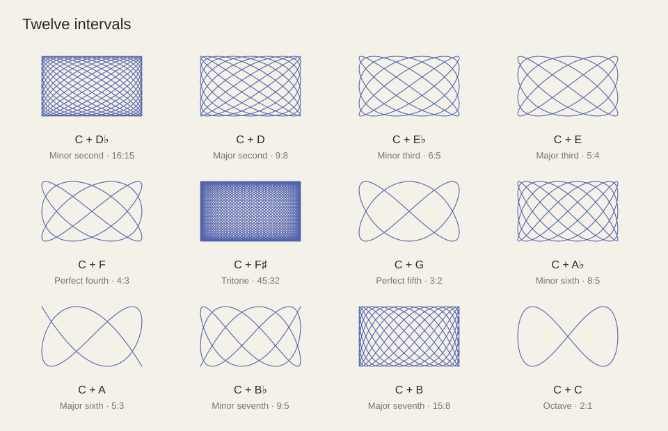
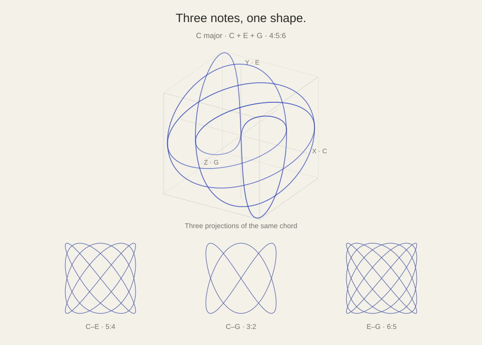

# Sound Shapes

**See what you hear.** An interactive listening room for exploring musical intervals and three-note chords through sound and shape.



## Listen and explore

- **Intervals:** compare twelve pairs of notes and their two-dimensional curves.
- **Chords:** hear Major, Minor, Diminished, and Cluster examples. Rotate the 3D shape and unfold its three pairwise projections.
- **Timbre:** choose Soft for gentle harmonics or Pure for sine tones.
- **Drawing:** adjust visual phase or pause tracing without changing the pitches.



## Run locally

No dependencies or build step. From the repository directory:

```sh
python3 -m http.server 8000
```

Open [localhost:8000](http://localhost:8000) and press Play. Use an HTTP server rather than opening the HTML file directly.

## About the shapes

Each axis follows one note’s fundamental sine signal. Frequency ratios create repeating trajectories; a third note adds depth. These are mathematical pictures, not sound’s path through air. **Visual complexity does not measure consonance.** The examples use rational tunings that can differ from an equal-tempered piano.

Built with HTML, CSS, JavaScript, Web Audio, SVG, and Canvas. See the [project documentation](docs/README.md) for the scientific model, tuning choices, and implementation details.
